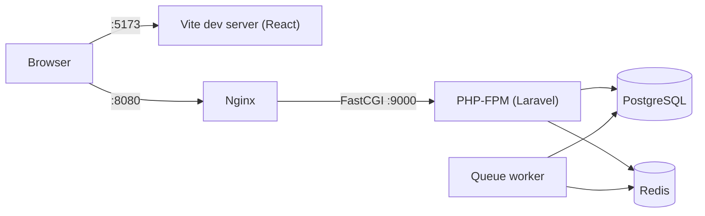

# AutoPulse

A multi-tenant SaaS platform that helps small and mid-sized fleet operators track vehicle
health, schedule preventive maintenance and monitor telematics data from a single dashboard.

> **Status:** Under active development. Authentication and multi-tenancy are complete;
> application features are being built phase by phase (see [Roadmap](#roadmap)).

## Planned Features (MVP)

- **Dashboard:** fleet availability, overdue and upcoming maintenance, open critical alerts.
- **Vehicles:** registry with search, filters and a detail page with history and telemetry.
- **Drivers & Assignments:** driver profiles with license expiry and a full assignment history.
- **Maintenance:** distance- or time-based service schedules that update after each service.
- **Telematics & Alerts:** device API for vehicle readings, with automatic alerts for
  overspeeding, high engine temperature, due maintenance and expiring licenses.

## Tech Stack

| Layer          | Technology                                                     |
|----------------|----------------------------------------------------------------|
| Backend        | PHP 8.4, Laravel 13, Laravel Sanctum                           |
| Database       | PostgreSQL 17                                                  |
| Cache & Queues | Redis 7                                                        |
| Frontend       | React 19, Vite 8, Tailwind CSS, TanStack Query, React Hook Form, Zod |
| Infrastructure | Docker Compose, Nginx                                          |
| Quality        | Pest, Laravel Pint, ESLint, GitHub Actions                     |

## Architecture



| Service    | Purpose                                                    |
|------------|------------------------------------------------------------|
| `nginx`    | Web server; forwards PHP requests to PHP-FPM               |
| `php`      | Laravel application running on PHP-FPM                     |
| `queue`    | Processes background jobs such as telemetry and alerts     |
| `postgres` | Primary relational database                                |
| `redis`    | Cache store and queue backend                              |
| `frontend` | Vite development server for the React single-page app      |

### Multi-Tenancy

Every organization's data lives in the same database, separated by an `organization_id` column.
After authentication, the `tenant` middleware sets the user's organization as the current tenant,
and an Eloquent global scope limits every query on tenant-owned models to that organization.
The scope fails closed: without a current tenant, queries return nothing.
See [ADR-005](docs/DECISIONS.md) for details.

## Getting Started

### Prerequisites

- [Docker Desktop](https://www.docker.com/products/docker-desktop/) with Docker Compose v2
- Git

### Run locally

```sh
git clone https://github.com/wbRayyan/AutoPulse.git
cd AutoPulse
docker compose up -d
```

On the first start, the `php` container automatically installs Composer dependencies,
creates `backend/.env` from `.env.example`, generates the application key and runs the
database migrations. PostgreSQL also creates a separate `autopulse_test` database for the
test suite. This can take a few minutes; later starts take seconds.

| Application | URL / Connection                                                   |
|-------------|--------------------------------------------------------------------|
| Frontend    | http://localhost:5173                                              |
| Backend API | http://localhost:8080                                              |
| PostgreSQL  | `localhost:5433` (databases `autopulse` and `autopulse_test`, user `autopulse`, password `secret`) |

## API

All endpoints are versioned under `/api/v1` and return JSON. Send `Accept: application/json`,
and for protected endpoints `Authorization: Bearer <token>`.

| Method | Endpoint                | Access                          | Description                                              |
|--------|-------------------------|---------------------------------|----------------------------------------------------------|
| POST   | `/api/v1/auth/register` | Public, 10 requests/min per IP  | Create an organization with its owner and return a token |
| POST   | `/api/v1/auth/login`    | Public, 5 attempts/min per email and IP | Return a new token for the user                  |
| GET    | `/api/v1/auth/me`       | Bearer token                    | Return the current user with their organization          |
| POST   | `/api/v1/auth/logout`   | Bearer token                    | Revoke the token used for the request                    |

## Common Commands

| Task                                  | Command                                            |
|---------------------------------------|----------------------------------------------------|
| Start all services                    | `docker compose up -d`                             |
| Stop all services                     | `docker compose down`                              |
| Reset everything (deletes all data)   | `docker compose down -v`                           |
| Follow backend logs                   | `docker compose logs -f php`                       |
| Run the test suite                    | `docker compose exec php php artisan test`         |
| Check code style                      | `docker compose exec php ./vendor/bin/pint --test` |
| Fix code style                        | `docker compose exec php ./vendor/bin/pint`        |
| Run an Artisan command                | `docker compose exec php php artisan <command>`    |
| Run a Composer command                | `docker compose exec php composer <command>`       |
| Run an npm command                    | `docker compose exec frontend npm <command>`       |
| Reload the queue worker after changes | `docker compose restart queue`                     |

## Project Structure

```text
AutoPulse/
├── backend/        Laravel API
├── frontend/       React single-page application (Vite)
├── docker/         Dockerfiles, service configuration and database init scripts
├── docs/           Product scope, data model and architecture decisions
└── compose.yaml    Local development environment
```

## Documentation

- [Product Scope](docs/PRODUCT_SCOPE.md): roles, user stories and non-functional requirements
- [Entity Relationship Diagram](docs/ERD.md): data model, index plan and design decisions
- [Architecture Decision Records](docs/DECISIONS.md): key technical decisions and trade-offs

## Roadmap

- [x] Phase 0: Product scope, data model and architecture decisions
- [x] Phase 1: Containerized development environment
- [x] Phase 2: Authentication and multi-tenancy
- [ ] Phase 3: Frontend shell and login
- [ ] Phase 4: Vehicles and drivers
- [ ] Phase 5: Maintenance
- [ ] Phase 6: Telematics and alerts
- [ ] Phase 7: Dashboard
- [ ] Phase 8: Hardening (tests, CI, documentation)
- [ ] Phase 9: Deployment and live demo

## License

This project is licensed under the [MIT License](LICENSE).# AutoPulse

A multi-tenant SaaS platform that helps small and mid-sized fleet operators track vehicle
health, schedule preventive maintenance and monitor telematics data from a single dashboard.

> **Status:** Under active development. Authentication and multi-tenancy are complete;
> application features are being built phase by phase (see [Roadmap](#roadmap)).

## Planned Features (MVP)

- **Dashboard:** fleet availability, overdue and upcoming maintenance, open critical alerts.
- **Vehicles:** registry with search, filters and a detail page with history and telemetry.
- **Drivers & Assignments:** driver profiles with license expiry and a full assignment history.
- **Maintenance:** distance- or time-based service schedules that update after each service.
- **Telematics & Alerts:** device API for vehicle readings, with automatic alerts for
  overspeeding, high engine temperature, due maintenance and expiring licenses.

## Tech Stack

| Layer          | Technology                                                     |
|----------------|----------------------------------------------------------------|
| Backend        | PHP 8.4, Laravel 13, Laravel Sanctum                           |
| Database       | PostgreSQL 17                                                  |
| Cache & Queues | Redis 7                                                        |
| Frontend       | React 19, Vite 8, Tailwind CSS, TanStack Query, React Hook Form, Zod |
| Infrastructure | Docker Compose, Nginx                                          |
| Quality        | Pest, Laravel Pint, ESLint, GitHub Actions                     |

## Architecture


| Service    | Purpose                                                    |
|------------|------------------------------------------------------------|
| `nginx`    | Web server; forwards PHP requests to PHP-FPM               |
| `php`      | Laravel application running on PHP-FPM                     |
| `queue`    | Processes background jobs such as telemetry and alerts     |
| `postgres` | Primary relational database                                |
| `redis`    | Cache store and queue backend                              |
| `frontend` | Vite development server for the React single-page app      |

### Multi-Tenancy

Every organization's data lives in the same database, separated by an `organization_id` column.
After authentication, the `tenant` middleware sets the user's organization as the current tenant,
and an Eloquent global scope limits every query on tenant-owned models to that organization.
The scope fails closed: without a current tenant, queries return nothing.
See [ADR-005](docs/DECISIONS.md) for details.

## Getting Started

### Prerequisites

- [Docker Desktop](https://www.docker.com/products/docker-desktop/) with Docker Compose v2
- Git

### Run locally

```sh
git clone https://github.com/wbRayyan/AutoPulse.git
cd AutoPulse
docker compose up -d
```

On the first start, the `php` container automatically installs Composer dependencies,
creates `backend/.env` from `.env.example`, generates the application key and runs the
database migrations. PostgreSQL also creates a separate `autopulse_test` database for the
test suite. This can take a few minutes; later starts take seconds.

| Application | URL / Connection                                                   |
|-------------|--------------------------------------------------------------------|
| Frontend    | http://localhost:5173                                              |
| Backend API | http://localhost:8080                                              |
| PostgreSQL  | `localhost:5433` (databases `autopulse` and `autopulse_test`, user `autopulse`, password `secret`) |

## API

All endpoints are versioned under `/api/v1` and return JSON. Send `Accept: application/json`,
and for protected endpoints `Authorization: Bearer <token>`.

| Method | Endpoint                | Access                          | Description                                              |
|--------|-------------------------|---------------------------------|----------------------------------------------------------|
| POST   | `/api/v1/auth/register` | Public, 10 requests/min per IP  | Create an organization with its owner and return a token |
| POST   | `/api/v1/auth/login`    | Public, 5 attempts/min per email and IP | Return a new token for the user                  |
| GET    | `/api/v1/auth/me`       | Bearer token                    | Return the current user with their organization          |
| POST   | `/api/v1/auth/logout`   | Bearer token                    | Revoke the token used for the request                    |

## Common Commands

| Task                                  | Command                                            |
|---------------------------------------|----------------------------------------------------|
| Start all services                    | `docker compose up -d`                             |
| Stop all services                     | `docker compose down`                              |
| Reset everything (deletes all data)   | `docker compose down -v`                           |
| Follow backend logs                   | `docker compose logs -f php`                       |
| Run the test suite                    | `docker compose exec php php artisan test`         |
| Check code style                      | `docker compose exec php ./vendor/bin/pint --test` |
| Fix code style                        | `docker compose exec php ./vendor/bin/pint`        |
| Run an Artisan command                | `docker compose exec php php artisan <command>`    |
| Run a Composer command                | `docker compose exec php composer <command>`       |
| Run an npm command                    | `docker compose exec frontend npm <command>`       |
| Reload the queue worker after changes | `docker compose restart queue`                     |

## Project Structure

```text
AutoPulse/
├── backend/        Laravel API
├── frontend/       React single-page application (Vite)
├── docker/         Dockerfiles, service configuration and database init scripts
├── docs/           Product scope, data model and architecture decisions
└── compose.yaml    Local development environment
```

## Documentation

- [Product Scope](docs/PRODUCT_SCOPE.md): roles, user stories and non-functional requirements
- [Entity Relationship Diagram](docs/ERD.md): data model, index plan and design decisions
- [Architecture Decision Records](docs/DECISIONS.md): key technical decisions and trade-offs

## Roadmap

- [x] Phase 0: Product scope, data model and architecture decisions
- [x] Phase 1: Containerized development environment
- [x] Phase 2: Authentication and multi-tenancy
- [ ] Phase 3: Frontend shell and login
- [ ] Phase 4: Vehicles and drivers
- [ ] Phase 5: Maintenance
- [ ] Phase 6: Telematics and alerts
- [ ] Phase 7: Dashboard
- [ ] Phase 8: Hardening (tests, CI, documentation)
- [ ] Phase 9: Deployment and live demo

## License

This project is licensed under the [MIT License](LICENSE).
