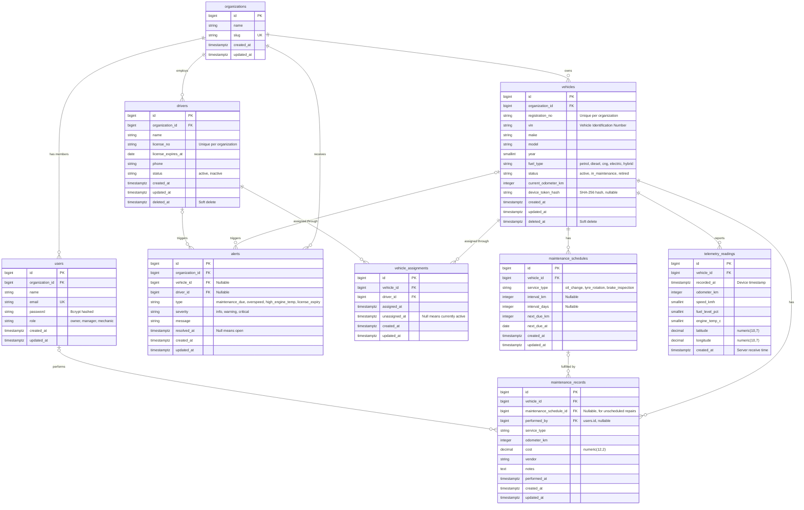

# AutoPulse – Entity Relationship Diagram

## Diagram

## Index Plan

PostgreSQL does not automatically index foreign key columns (unlike MySQL InnoDB),
so every index below is created explicitly in migrations.

| Table | Index | Type | Purpose |
|-------|-------|------|---------|
| users | (organization_id) | B-tree | Tenant scoping |
| vehicles | (organization_id, registration_no) | Unique | Prevent duplicate registrations within a tenant |
| vehicles | (organization_id, status) | B-tree | Filter vehicles by status |
| drivers | (organization_id, license_no) | Unique | Prevent duplicate licenses within a tenant |
| vehicle_assignments | (vehicle_id) WHERE unassigned_at IS NULL | Partial unique | Only one active driver per vehicle |
| vehicle_assignments | (driver_id) WHERE unassigned_at IS NULL | Partial unique | Only one active vehicle per driver |
| maintenance_schedules | (vehicle_id) | B-tree | Load schedules per vehicle |
| maintenance_records | (vehicle_id, performed_at) | B-tree | Service history ordered by date |
| telemetry_readings | (vehicle_id, recorded_at) | B-tree | Latest readings per vehicle |
| alerts | (organization_id, resolved_at) | B-tree | Fetch open alerts per tenant |

## Data Design Decisions

1. **Multi-tenancy via `organization_id`:** Top-level tables carry `organization_id`
   and are filtered automatically through an Eloquent global scope. Child tables
   (assignments, schedules, records, readings) inherit tenancy through their parent vehicle.
2. **Assignment history table:** Driver assignment is stored in `vehicle_assignments`
   instead of a `driver_id` column on `vehicles`, preserving a full audit trail.
3. **Partial unique indexes:** PostgreSQL partial indexes enforce "one active assignment"
   at the database level, so data stays correct even if application code has a bug.
4. **Money as `numeric(12,2)`:** Floating-point types cause rounding errors and are never used for currency.
5. **`timestamptz` in UTC:** All timestamps are stored in UTC and converted to local time only in the UI.
6. **Enums as strings + PHP backed enums:** Avoids PostgreSQL native enum types, which
   require migrations to add or rename values.
7. **Soft deletes on vehicles and drivers:** Historical records (maintenance, assignments)
   keep valid references after an entity is retired.
8. **Alerts use nullable foreign keys instead of polymorphic relations:** Polymorphic
   columns cannot have real foreign key constraints; two nullable FKs keep referential integrity.
9. **Hashed device tokens:** Only a SHA-256 hash is stored. A database leak does not expose usable device credentials.
10. **Separate `recorded_at` and `created_at` on telemetry:** Distinguishes when the device
    measured data from when the server received it, which matters for delayed or offline uploads.